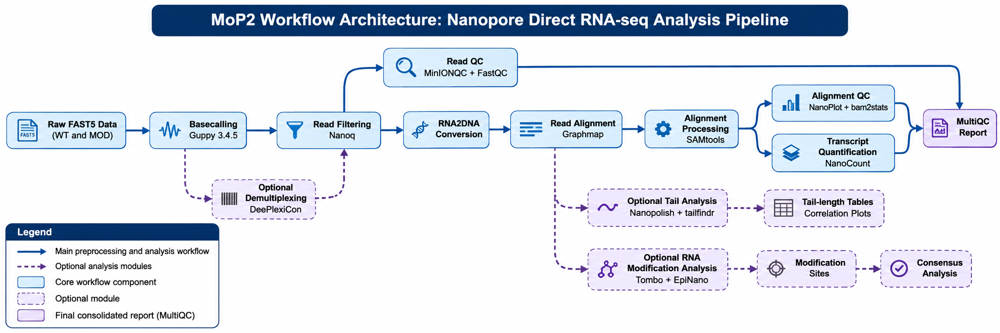

# Nanopore Direct RNA-seq Analysis Pipeline
### End-to-End Workflow Implementation Using Nextflow DSL2 and Docker

An implementation and adaptation of the Master of Pores 2 (MoP2) methodology for Oxford Nanopore Direct RNA Sequencing (dRNA-seq), integrating basecalling, quality control, read filtering, alignment and transcript quantification through a modular Nextflow workflow.

## 1. Project Overview

Oxford Nanopore Direct RNA Sequencing enables direct sequencing of RNA molecules, providing information about transcript abundance, RNA processing and RNA modifications.

This project focuses on implementing a reproducible computational workflow for processing Oxford Nanopore Direct RNA sequencing data, following the published Master of Pores 2 methodology.

The workflow integrates multiple bioinformatics tools using Nextflow DSL2 and Docker to coordinate individual analytical stages, manage computational dependencies and enable reproducible execution.

The implementation includes workflow configuration, integration of bioinformatics tools, adaptation of legacy Nextflow modules and compatibility improvements for modern computational environments.

## 2. Project Objectives

- Implement a modular Nanopore Direct RNA-seq analysis workflow.
- Process raw FAST5 data through basecalling and FASTQ generation.
- Perform read quality assessment and filtering.
- Execute reference-based read alignment.
- Process alignment files and perform transcript quantification.
- Integrate bioinformatics tools using Nextflow DSL2.
- Configure containerized execution using Docker.
- Adapt legacy workflow components for modern Nextflow compatibility.
- Establish reproducible workflow execution.

## 3. Workflow Architecture



*Figure 1. Workflow architecture illustrating Nanopore direct RNA-seq preprocessing, alignment, quality assessment, transcript quantification and optional downstream analytical modules.*

### Core workflow components

| Stage | Tool | Function |
|---|---|---|
| Basecalling | Guppy | FAST5 to FASTQ conversion |
| Demultiplexing | DeePlexiCon | Optional read classification |
| Filtering | Nanoq | Read quality filtering |
| RNA conversion | RNA2DNA | RNA-to-DNA conversion |
| Alignment | Graphmap | Reference-based alignment |
| Alignment processing | SAMtools | BAM/CRAM processing |
| Read QC | MinIONQC, FastQC | Sequencing quality assessment |
| Alignment QC | NanoPlot, bam2stats | Alignment quality assessment |
| Quantification | NanoCount | Transcript abundance estimation |
| Reporting | MultiQC | Consolidated QC reporting |

Optional downstream modules include poly(A) tail analysis using Nanopolish and tailfindr, and RNA modification analysis using Tombo and EpiNano.

## 4. Experimental Data

The initial implementation uses two experimental sample groups:

| Sample | Input | Approximate size |
|---|---|---:|
| MOD | `data/mod/batch_0.fast5` | 50 MB |
| WT | `data/wt/batch_0.fast5` | 49 MB |

**Reference:** `anno/yeast_rRNA_ref.fa.gz`

The reference contains yeast ribosomal RNA sequences, including 5S, 5.8S and 18S rRNA.

### Sequencing configuration

| Parameter | Value |
|---|---|
| Sequencing technology | Oxford Nanopore |
| Sequencing type | Direct RNA |
| Flow cell | FLO-MIN106 |
| Kit | SQK-RNA002 |
| Basecaller | Guppy 3.4.5 |
| Filtering | Nanoq |
| Mapping | Graphmap |
| Quantification | NanoCount |
| GPU | Disabled |

## 5. Technology Stack

| Category | Tools |
|---|---|
| Workflow management | Nextflow DSL2 |
| Programming | Python, Bash |
| Environment management | Conda |
| Containerization | Docker |
| Operating system | Ubuntu 22.04, WSL2 |
| Basecalling | Guppy |
| Quality control | MinIONQC, FastQC, NanoPlot |
| Filtering | Nanoq |
| Alignment | Graphmap |
| Alignment processing | SAMtools |
| Quantification | NanoCount |
| Reporting | MultiQC |
| Version control | Git, GitHub |

## 6. Implementation and Engineering

### Workflow integration
Configured the modular Nextflow architecture to coordinate individual bioinformatics processes through defined inputs, outputs and execution dependencies.

### Nextflow compatibility
Adapted legacy workflow components for compatibility with Nextflow 26.10.5.

Modifications included:
- Legacy syntax parser configuration.
- Updating optional process output declarations.
- Modifying affected process definitions.
- Adapting selected BioNextflow subworkflow modules.

### Containerized execution
Configured Docker Engine within Ubuntu WSL2 and integrated containerized execution through Nextflow.

### Basecalling and read processing
Integrated Guppy 3.4.5 for FAST5-to-FASTQ conversion and configured Nanoq for read filtering.

### Alignment and quantification
Configured Graphmap for reference-based alignment, SAMtools for alignment processing and NanoCount for transcript-level quantification.

### Quality control
Integrated MinIONQC, FastQC, NanoPlot and bam2stats, with MultiQC configured for consolidated quality-control reporting.

## 7. Installation and Setup

### Prerequisites

- Ubuntu/Linux or WSL2
- Conda
- Java 17 or later
- Nextflow 26.10.5
- Docker Engine
- Guppy 3.4.5

### Clone this implementation

Replace `YOUR_GITHUB_USERNAME` with your GitHub username.

```bash
git clone --recurse-submodules \
https://github.com/sanketVarak/nanopore-drna-seq-pipeline

cd MOP2
```

### Create the Conda environment

```bash
conda create -n mop2 \
-c conda-forge -c bioconda \
nextflow openjdk=17 -y

conda activate mop2
```

### Verify Docker

```bash
docker version
docker run hello-world
```

### Install Guppy

```bash
bash INSTALL.sh 3.4.5
```

Guppy must be downloaded separately and should not be committed to this repository.

## 8. Configuration

Important configuration files:

```text
mop_preprocess/
├── mop_preprocess.nf
├── config.yaml
├── nextflow.config
├── params.config
└── drna_tool_splice_opt.tsv
```

Configure the FAST5 input directory, reference sequence, sequencing chemistry, filtering, mapping and quantification parameters according to the dataset.

## 9. Workflow Execution

Navigate to the preprocessing directory:

```bash
cd mop_preprocess
```

Set the compatibility parser:

```bash
export NXF_SYNTAX_PARSER=v1
```

Execute:

```bash
nextflow run mop_preprocess.nf \
-with-docker \
-profile local
```

Resume a previous execution:

```bash
nextflow run mop_preprocess.nf \
-with-docker \
-profile local \
-resume
```

## 10. Execution and Validation

The initial implementation was configured using two FAST5 experimental samples, MOD and WT.

The following stages have been successfully executed:

| Stage | Validated result |
|---|---|
| FAST5 input detection | Successful |
| Reference validation | Successful |
| Guppy basecalling | 2/2 tasks |
| Nanoq filtering | 2/2 tasks |
| MinIONQC | 2/2 tasks |
| RNA2DNA conversion | 2/2 tasks |
| FASTQ concatenation | 2/2 tasks |

The downstream Graphmap alignment, SAMtools processing, NanoCount quantification and MultiQC reporting modules are integrated into the workflow and remain subject to final end-to-end output validation.

## 11. Reproducibility

The workflow uses Nextflow and Docker to support:

- Modular process execution.
- Automatic container image retrieval.
- Task-level execution tracking.
- Process-level logging.
- Cached intermediate results.
- Execution resumption using `-resume`.
- Reproducible software environments.

## 12. Future Development

- Complete downstream execution validation.
- Implement automated input validation.
- Extend support for multiple sequencing samples.
- Develop integrated QC summaries.
- Evaluate alignment quality and transcript quantification.
- Integrate optional poly(A) tail and RNA modification analyses.
- Benchmark runtime and computational resource utilization.

## 13. Research References

The scientific methodology and workflow architecture are based on the following publications.

**Reference 1 — Master of Pores 2 methodology**

Cozzuto, L., Delgado-Tejedor, A., Hermoso Pulido, T., Novoa, E. M., & Ponomarenko, J. (2023).

*Nanopore Direct RNA Sequencing Data Processing and Analysis Using MasterOfPores.*

Methods in Molecular Biology, 2624, 185–205.

https://doi.org/10.1007/978-1-0716-2962-8_13

**Reference 2 — Original MasterOfPores workflow**

Cozzuto, L., Liu, H., Pryszcz, L. P., Hermoso Pulido, T., Delgado-Tejedor, A., Ponomarenko, J., & Novoa, E. M. (2020).

*MasterOfPores: A Workflow for the Analysis of Oxford Nanopore Direct RNA Sequencing Datasets.*

Frontiers in Genetics, 11, 211.

https://doi.org/10.3389/fgene.2020.00211

### Original Software and Methodology

The implementation follows the published Master of Pores 2 methodology and uses its original open-source workflow as a technical reference.

- Original MOP2 repository: https://github.com/biocorecrg/MOP2
- Original BioNextflow repository: https://github.com/biocorecrg/BioNextflow

The original developers retain credit for the published methodology and software. This repository documents the implementation, workflow adaptations, compatibility modifications and reproducibility work carried out in this project.

---

**Project:** Nanopore Direct RNA-seq Analysis Pipeline

**Workflow framework:** Nextflow DSL2

**Execution environment:** Conda, Docker, Ubuntu WSL2